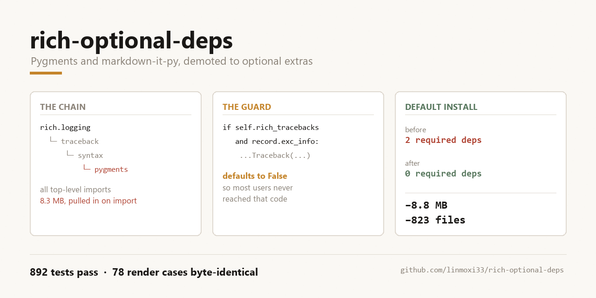

# rich-optional-deps

**Pygments and markdown-it-py, demoted from required dependencies to optional extras — without changing a single byte of rendered output.**

A patch against [`Textualize/rich`](https://github.com/Textualize/rich) 14.1.0.



---

## The problem

`rich` 14.1.0 declares two required runtime dependencies:

```toml
[tool.poetry.dependencies]
pygments = "^2.13.0"          # 8.3 MB, 676 files
markdown-it-py = ">=2.2.0"    # 0.5 MB, 134 files
```

Both are used in exactly three files:

| Dependency | Used in |
|---|---|
| `pygments` | `rich/syntax.py`, `rich/traceback.py` |
| `markdown-it-py` | `rich/markdown.py` |

The interesting part is *how* Pygments gets pulled in. There is a module-level
import chain:

```
rich.logging ──▶ rich.traceback ──▶ rich.syntax ──▶ pygments
```

…but `rich.logging` only uses `Traceback` conditionally:

```python
# rich/logging.py
def emit(self, record):
    traceback = None
    if self.rich_tracebacks and record.exc_info:   # default: False
        traceback = Traceback.from_exception(...)
```

`RichHandler(rich_tracebacks=False)` is the default. So **someone who only wants
coloured log output — and will never enable rich tracebacks — still pays for
8.3 MB of Pygments at import time.**

There is a second, quieter absurdity: `rich.syntax` already ships a
Pygments-free theme implementation (`ANSISyntaxTheme`), but the top-level
`from pygments...` import means that code path can never be reached when
Pygments is absent.

## What this patch does

| File | Change |
|---|---|
| `rich/_syntax_themes.py` | **New.** ANSI theme tables keyed by plain tuples — zero Pygments imports |
| `rich/syntax.py` | Pygments imports moved to `TYPE_CHECKING` + in-function lazy imports; `get_theme` degrades to `ansi_dark` with one warning; `lexer` / `default_lexer` return `None` so code renders as plain text |
| `rich/traceback.py` | Top-level Pygments imports removed; theme table uses tuples; `_guess_lexer` imports lazily and degrades to `"text"` |
| `rich/markdown.py` | `Token` moved to `TYPE_CHECKING`; `MarkdownIt` imported at construction, with an actionable `ImportError` when missing |
| `pyproject.toml` | Both dependencies marked `optional`; new `syntax`, `markdown`, `all` extras |

### The trick that makes it work

Pygments token types are `tuple` subclasses whose hash and equality behave
exactly like the equivalent plain tuple:

```python
Token.Comment.Preproc == ("Comment", "Preproc")   # True
hash(Token.Comment) == hash(("Comment",))         # True
```

So the built-in ANSI theme tables can be keyed by plain tuples and used without
importing Pygments at all. `ANSISyntaxTheme` already resolves a token by
progressively truncating the tuple, so a tuple key and a Pygments token key
resolve to the same entry. Verified over 16 probes (including subtype fallback
and unknown tokens) with **0 differences**.

### Degradation is explicit, never silent

The design goal was "render something and say what happened", not "crash":

| Situation | Behaviour |
|---|---|
| Pygments theme requested, Pygments absent | Falls back to `ansi_dark`, emits **one** `UserWarning` mentioning `pip install 'rich[syntax]'` |
| Built-in `ansi_light` / `ansi_dark` theme | Works silently, **no warning** |
| `Markdown` used, `markdown-it-py` absent | `ImportError` naming the dependency and the extras command |
| Any of the above | Code still renders — never blank, never a crash |

## Install

Nothing to install for the patch itself. To use the extras after applying it:

```bash
pip install 'rich[syntax]'     # Pygments themes + lexers + lexer guessing
pip install 'rich[markdown]'   # Markdown rendering
pip install 'rich[all]'        # everything optional
pip install rich               # core only: tables, panels, progress, logging
```

## Apply

```bash
curl -L https://github.com/Textualize/rich/archive/refs/tags/v14.1.0.tar.gz | tar xz
cd rich-14.1.0
git apply /path/to/patches/0001-optional-deps.patch
cp /path/to/rich/_syntax_themes.py rich/
cp /path/to/tests/test_optional_deps.py tests/
```

## Verification

Every number below was produced by the scripts in `tools/`, which are included
so you can reproduce them rather than take my word for it.

### Test suite

| | Result |
|---|---|
| Upstream baseline (unpatched) | 883 passed, 23 skipped |
| Patched | **892 passed, 23 skipped** (883 + 9 new) |

The 9 new tests in `tests/test_optional_deps.py` cover: tuple-keyed themes,
token/tuple resolution parity, rendering without Pygments, the fallback warning,
silence for built-in themes, `guess_lexer` degradation, import isolation for
`rich.logging` / `rich.traceback`, and the `Markdown` error message.

> **Pin Pygments to 2.19.2 when running the suite.** The upstream tests are
> snapshot-based and version-sensitive: 2.21 gives 7 failures, 2.18 and 2.17
> give 3 each, 2.19.2 is the only version where the baseline is fully green.
> This is a pre-existing property of upstream's tests, not something this patch
> introduces — but it will waste your time if you don't know it.

### Byte-identical rendering

With Pygments installed (i.e. the full feature set), the same 78 render cases
were run against pristine and patched trees and compared byte for byte:

| Coverage | Cases |
|---|---|
| `Syntax` × 13 themes × line-numbers/word-wrap | 52 |
| `Syntax` line range, highlighted lines, indent guides, `from_path`, `guess_lexer` | 3 |
| `Traceback` × 5 themes × locals on/off | 10 |
| `RichHandler` (plain / rich traceback / multiple themes) | 4 |
| `Markdown` (default / custom code theme) | 2 |
| `Table`, `Panel`, `Tree`, `Pretty`, `JSON` | 5 |
| ANSI theme token resolution (30 tokens each) | 2 |

**Result: 78/78 identical, 0 differences.**

```bash
python tools/render_matrix.py /path/to/pristine  base.json
python tools/render_matrix.py /path/to/patched   new.json
python tools/compare_render.py base.json new.json
# captures: base=78 new=78 shared=78
# identical: 78/78
# OK: all captures are byte-identical
```

### Real minimal environment

A separate venv with neither Pygments nor markdown-it-py, then
`pip install --no-deps .` — installation succeeds and pip does **not** pull
Pygments in. All 19 checks in `tools/check_minimal_env.py` pass:

```
[PASS] pygments absent
[PASS] RichHandler renders a rich traceback
[PASS] logging did not import pygments
[PASS] Syntax warns about the Pygments fallback
[PASS] markdown raises actionable ImportError
...
ALL CHECKS PASSED
```

Installing Pygments afterwards restores full theme support.

### Do the new tests actually test anything?

Mutation checks, to confirm they aren't vacuously green:

| Mutation | Expected | Actual |
|---|---|---|
| Delete the `get_theme` fallback branch | fallback test fails | ✅ exactly 1 failure |
| Re-add a top-level `import pygments` to `syntax.py` | import-isolation tests fail | ✅ exactly 2 failures |

### Static checks

| Check | Before | After |
|---|---|---|
| `mypy rich` (strict) | 1 error (pre-existing) | **1 error (same one)** |
| `black --check rich` | 79 files unchanged | **79 files unchanged** |

## What this patch buys you

### Install footprint

| | Before | After (default install) |
|---|---|---|
| Required runtime dependencies | 2 | **0** |
| Extra download | ≈ **8.8 MB** | **0 MB** |
| Extra files | **823** | **0** |

### Import time

Interleaved A/B, 15 rounds, fresh interpreter per sample, both trees
byte-compiled first. Modules the patch does not touch act as controls and
establish the noise floor.

| Module | Before | After | Change |
|---|---|---|---|
| `rich.console` | 175.8 | 174.2 | −1% *(control)* |
| `rich.table` | 110.8 | 109.0 | −2% *(control)* |
| `rich.live` | 190.4 | 190.4 | 0% *(control)* |
| `rich.logging` | 252.8 | 204.0 | **−19%** |
| `rich.traceback` | 264.4 | 201.0 | **−24%** |
| `rich.syntax` | 263.2 | 200.1 | **−24%** |
| `rich.markdown` | 359.8 | 196.1 | **−46%** |

Controls stayed within ±4%, so a 19–46% drop on the affected modules is well
outside the noise.

> A later re-run on a busier machine showed a control-group noise floor of 15%,
> which is exactly why the control group is there — treat small deltas as no
> change. The table above is from the stable run.

### What this patch does *not* claim

Being explicit, because it's easy to over-read a change like this:

- **No rendering performance improvement.** The render paths are logically
  unchanged; steady-state rendering speed should be identical. Not measured,
  not claimed.
- **Not fewer lines of code.** Library code grows by **120 lines**
  (`syntax.py` +19, `traceback.py` +11, `markdown.py` +8, new
  `_syntax_themes.py` +82), plus 162 lines of tests. What you buy is
  *optionality*, not brevity.
- **No memory claim.** Only import time and disk footprint were measured.
- Import time is a **one-off cost**. Long-lived processes (web servers,
  daemons) gain essentially nothing. The wins are in short-lived CLIs and in
  install / CI time.

## Compatibility

| Aspect | Impact |
|---|---|
| Public API | `ANSI_LIGHT`, `ANSI_DARK`, `RICH_SYNTAX_THEMES` still importable from `rich.syntax` |
| With Pygments installed | **Identical behaviour** (78 cases, 0 byte differences) |
| Without Pygments | Core works; Pygments themes degrade with a warning; `Markdown` raises an actionable error |
| Upgrade path | Users get a clear "install `rich[syntax]`" hint instead of `ModuleNotFoundError` |

The only behaviour change is for "no Pygments installed, but a Pygments theme
requested" — from *fails at import* to *degrades at runtime with a warning*.
That is an improvement, not a break.

## Repository layout

```
rich/
  _syntax_themes.py     tuple-keyed ANSI theme tables (no Pygments)
  syntax.py             lazy imports + ANSI fallback
  traceback.py          lazy imports + tuple theme table
  markdown.py           actionable ImportError
tests/
  test_optional_deps.py 9 contract tests for the above
patches/
  0001-optional-deps.patch   unified diff vs v14.1.0
tools/
  render_matrix.py      dump 78 render cases to JSON
  compare_render.py     byte-compare two matrices, exit non-zero on diff
  bench_import.py       interleaved A/B import benchmark (with pre-warm)
  check_minimal_env.py  19 checks for a Pygments-free environment
assets/
  make_cover.py         generates cover.png
```

## License

The patch touches MIT-licensed code and is provided under the same MIT terms.
`rich` is © Will McGugan and contributors.
